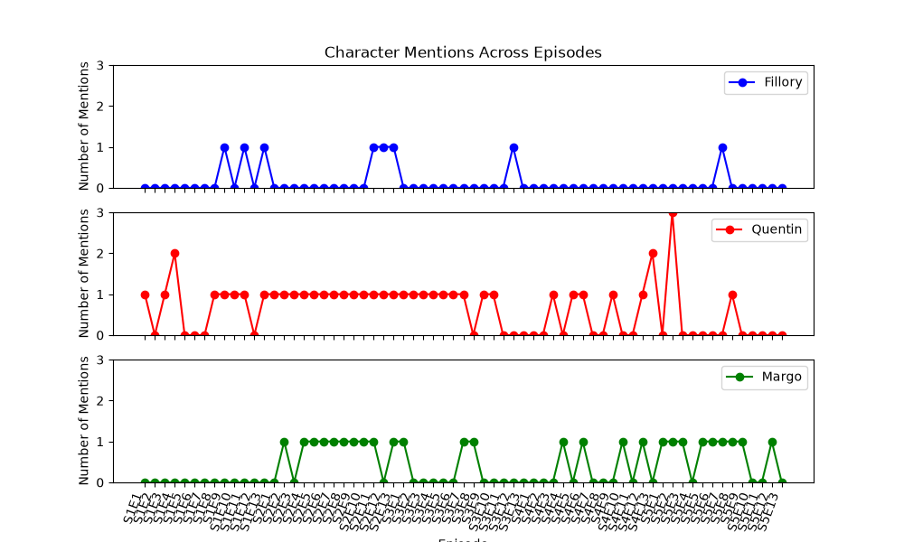

# Module 4: The Magicians Episode Summary Mentions

**Alex Heyert | November 2026**

[](pyproject.toml)
[](https://github.com/ajaneh/nlp-04-api-text-data-json/actions/workflows/ci-python-zensical.yml)
[](https://ajaneh.github.io/nlp-04-api-text-data-json/)

## Project overview

This project adapts an API-based Extract, Validate, Transform, and Load
(EVTL) workflow to episode-summary data for
[*The Magicians*](https://www.tvmaze.com/shows/3083/the-magicians). It
retrieves episode JSON from TVmaze, selects fields into one row per episode,
cleans the summaries, counts mentions of Fillory, Quentin, and Margo, and
plots the counts for analysis.

The repository is
[ajaneh/nlp-04-api-text-data-json](https://github.com/ajaneh/nlp-04-api-text-data-json).
The [project report](docs/index.md) documents the data, methods, results, and
open interpretation questions. The [Professional Python Workflow Guide](https://denisecase.github.io/pro-analytics-02/)
is the environment setup reference.

## Data and results

The configured endpoint is
[TVmaze show 3083 episodes](https://api.tvmaze.com/shows/3083/episodes).
The saved [raw JSON](https://github.com/ajaneh/nlp-04-api-text-data-json/blob/main/data/raw/magicians_request_raw.json)
contains 65 episode records. The processed
[CSV](https://github.com/ajaneh/nlp-04-api-text-data-json/blob/main/data/processed/magicians_request_processed.csv)
has one row per episode.

Across the summaries, the saved counts are 8 Fillory mentions, 42 Quentin
mentions, and 26 Margo mentions. The chart displays each episode's count;
these totals are sums across the 65 CSV rows.



[Open the chart in the repository](https://github.com/ajaneh/nlp-04-api-text-data-json/blob/main/docs/images/character_mentions_distribution.png).

## Set up and run

From a fresh terminal at the repository root, run these commands in order:

1. Install the project and its locked dependencies:

   ```shell
   uv sync
   ```

2. Run the custom pipeline:

   ```shell
   uv run python -m custom_nlp.pipeline_api_json
   ```

The pipeline requests the live TVmaze endpoint and opens the chart in a plot
window; close the window to finish. Running it overwrites
`data/raw/magicians_request_raw.json`,
`data/processed/magicians_request_processed.csv`, and
`data/processed/character_mentions_distribution.png`.

## Verification

Run the automated tests with:

```shell
uv run python -m pytest
```

The tests use a mocked TVmaze response and do not call the live API.
## Developer Reference

Follow the
[Professional Python Workflow Guide](https://denisecase.github.io/pro-analytics-02/)
for **detailed instructions and troubleshooting**.

### Initialize and Update the Python Environment

With the project open in VS Code, open a VS Code terminal.
Paste each command and hit Enter or Return after to run it.

```shell
uvx pup-clean --delete
uv self update
uv python pin 3.14
uv python install
uv lock --upgrade
uv sync
uv audit
```

### Set Up and Run Git Hooks

Set up and run the git hooks to perform
basic checks automatically before
any changes get pushed to GitHub.

In the VS Code terminal,
paste each command and hit Enter or Return after to run it.

```shell
uvx prek install --force
uvx prek update --freeze --cooldown-days 7

git add -A
uvx prek run --all-files
# repeat if changes were made
uvx prek run --all-files
```

### Run Common Chores

Run linters, formatters, type checks, tests, and
build the documentation.

```shell
uv run ruff check . --fix
uv run ruff format .

uv run ty check
uv run python -m pytest
uv run python -m zensical build
```

### Git add-commit-push to GitHub

After making useful changes, save your work to GitHub.

```shell
git add -A
git commit -m "describe your changes in quotes"
git push -u origin main
```

## Links

- [Project documentation site](https://ajaneh.github.io/nlp-04-api-text-data-json/)
- [Adapted example project](https://github.com/denisecase/nlp-04-api-text-data)
- [TVmaze episode data source](https://api.tvmaze.com/shows/3083/episodes)
