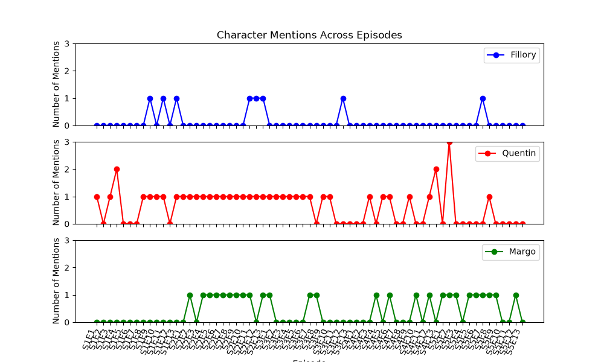

# Module 4: The Magicians Episode Summary Mentions

## 1. Opening

**Alex Heyert | November 2026**

This project adapts an API-based Extract, Validate, Transform, and Load
(EVTL) pipeline to episode-summary data for *The Magicians*.

## 2. Data

The configured source is the [TVmaze episodes endpoint for show 3083](https://api.tvmaze.com/shows/3083/episodes).
TVmaze identifies show 3083 as [*The Magicians*](https://www.tvmaze.com/shows/3083/the-magicians).
The saved response is a top-level JSON list with 65 episode records. Each
record represents one episode and includes fields such as `id` (integer),
`url` and `name` (strings), `season` and `number` (integers), `summary`
(HTML-formatted string), and nested `rating`, `image`, and `_links` objects.
`rating.average` is numeric in the saved response.

The transform selects these fields:

| JSON field | CSV field | Meaning |
| --- | --- | --- |
| `id` | `id` | TVmaze episode identifier |
| `season` | `season` | Season number |
| `number` | `episode_number` | Episode number in its season |
| `name` | `title` | Episode title |
| `summary` | `summary` | Cleaned episode summary |
| `rating.average` | `rating` | Episode rating |

Artifacts: [saved raw JSON](https://github.com/ajaneh/nlp-04-api-text-data-json/blob/main/data/raw/magicians_request_raw.json)
and [processed CSV](https://github.com/ajaneh/nlp-04-api-text-data-json/blob/main/data/processed/magicians_request_processed.csv).

## 3. Techniques Applied

The pipeline reuses techniques in the
[adapted example project](https://github.com/denisecase/nlp-04-api-text-data):
Requests retrieves JSON; Extract preserves the raw response; Validate inspects
the structure; Transform selects fields and builds a Polars DataFrame; Load
writes a CSV; and the stages use the project logger for execution details.
These patterns appear in `src/nlp/` and are adapted in `src/custom_nlp/`.

## 4. Custom Modifications

The custom pipeline changes the configured API to TVmaze show 3083 and saves
the response and transformed table as
`data/raw/magicians_request_raw.json` and
`data/processed/magicians_request_processed.csv`. It adds episode season and
number, title and rating to the selected fields, cleans the summary, and
derives a season/episode label plus Fillory (main subject), Quentin (main character), and Margo (favorite character) mention counts. Stage 05 adds a visualization of those counts.

## 5. Methods and Settings

In Transform, each summary is cleaned with
`re.sub(r"<[^>]+>", " ", summary)`, then HTML entities are decoded with
`html.unescape`, and surrounding whitespace is removed with `.strip()`.
Polars counts whole-word matches with case-insensitive patterns:
`(?i)\bfillory\b`, `(?i)\bquentin\b`, and `(?i)\bmargo\b`.
`season_episode` combines the numeric season and episode into labels such as
`S1E1`.

The visualizer reads the saved CSV and draws three vertically aligned
shared X axis plots. Each y value is the number of specific words mentioned in that episode's summary.

## 6. Verification

- `uv run python -m pytest -q` — 4 tests passed. The custom smoke test mocks
  the HTTP request; it checks the custom endpoint, stages, CSV fields, and
  derived mention counts without making a live API call.
- `uv run python -m custom_nlp.pipeline_api_json` — completed successfully.

## 7. Results

The processed CSV contains 65 episodes, 13 in each of five seasons. Summing
the per-episode counts gives:

| Season | Episodes | Fillory mentions | Quentin mentions | Margo mentions |
| --- | ---: | ---: | ---: | ---: |
| 1 | 13 | 3 | 9 | 0 |
| 2 | 13 | 3 | 13 | 10 |
| 3 | 13 | 1 | 9 | 3 |
| 4 | 13 | 0 | 7 | 4 |
| 5 | 13 | 1 | 4 | 9 |
| **All** | **65** | **8** | **42** | **26** |

Across individual episode summaries, Quentin appears in 38 summaries and
reaches 3 mentions in one episode. Fillory appears in 8 summaries and Margo
in 26; neither exceeds one mention in a summary.

## 8. Observations Interpretation and Insights

 As Margo becomes integral to Fillory, her name seems to replace mentions of Fillory. The season totals show higher Margo counts than Fillory counts in Seasons 2–5, but not a smooth replacement: Margo moves from 10 mentions in Season 2 to 3 in Season 3, while Fillory has few mentions overall.

## 9. Limitations

The Magicians (thus this dataset) is known for it's short pithy summaries and titles.

The data consists of TVmaze episode summaries, not scripts, dialogue, or
complete episode descriptions.

The Validate stage checks only that the response is a non-empty list and
every item is a dictionary. It does not enforce required keys or field types.

## 10. Next Steps

One interesting next step could be to use the rating information and summary text to look for any links, or see if some characters are more popular (have higher average ratings in shows where they're mentioned) than others.

Project links: [repository](https://github.com/ajaneh/nlp-04-api-text-data-json),
[project documentation site](https://ajaneh.github.io/nlp-04-api-text-data-json/),
[adapted example project](https://github.com/denisecase/nlp-04-api-text-data),
[TVmaze show page](https://www.tvmaze.com/shows/3083/the-magicians), and
[TVmaze episode API](https://api.tvmaze.com/shows/3083/episodes).
The [Professional Python Guide](https://denisecase.github.io/pro-analytics-02/)
is retained as a project resource.
